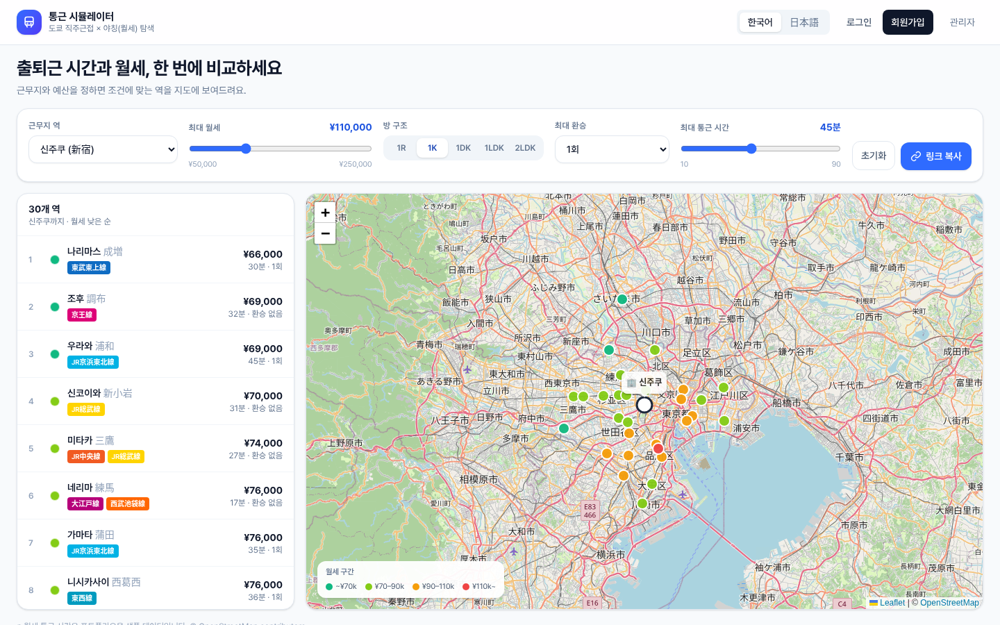
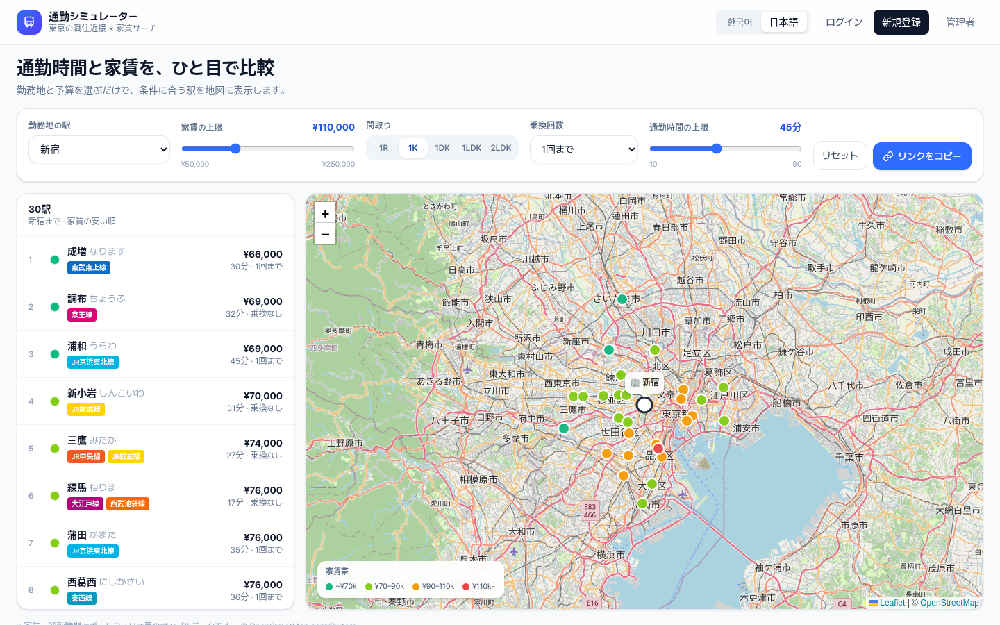
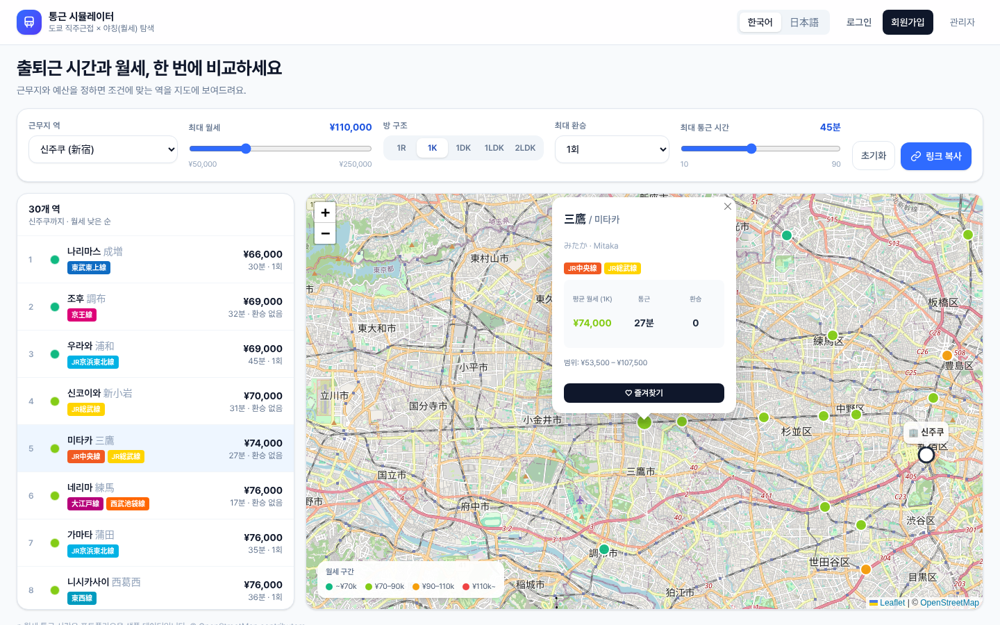
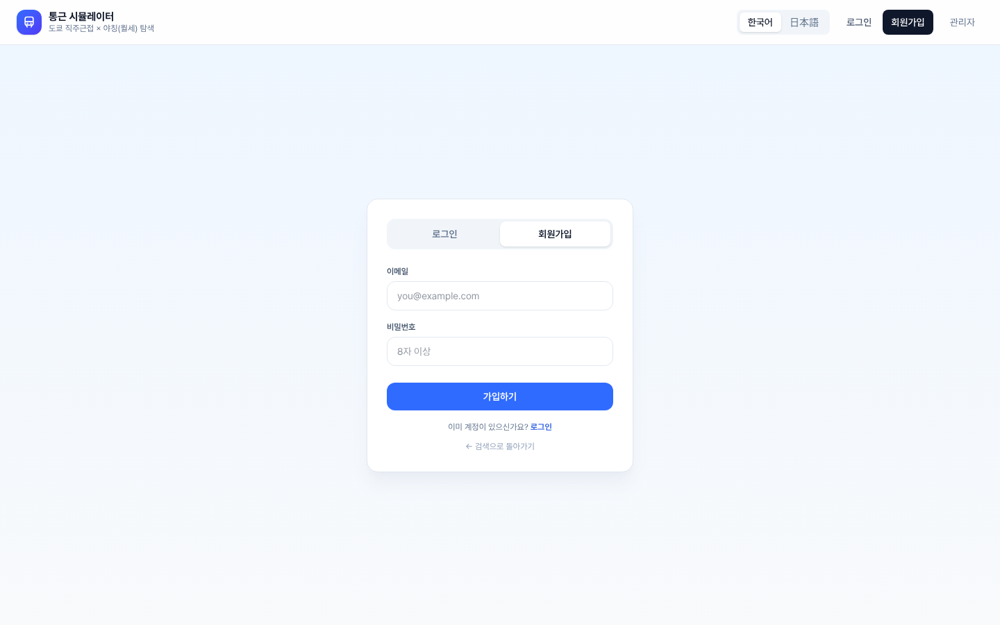
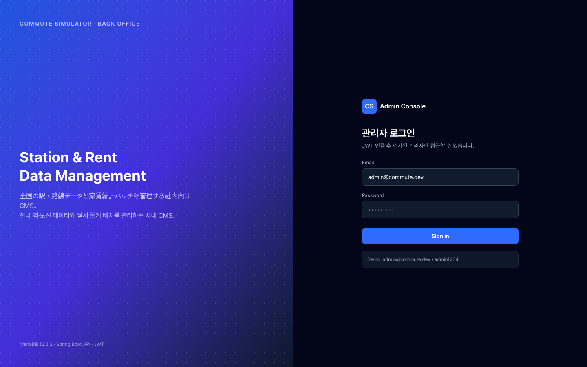
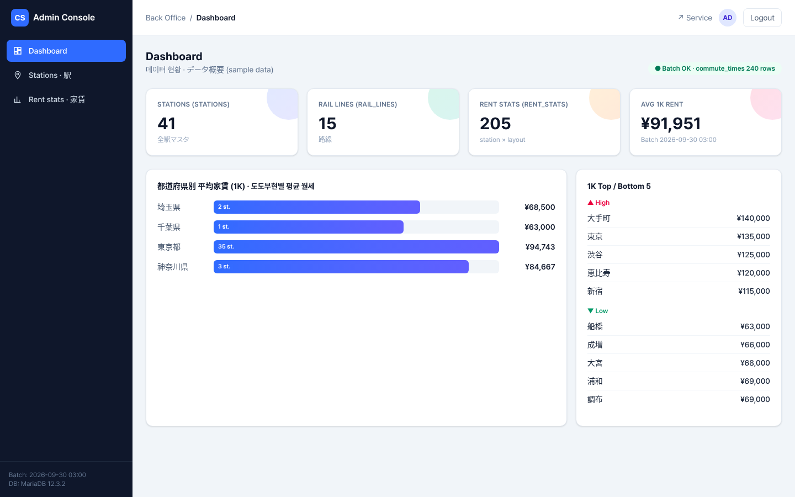
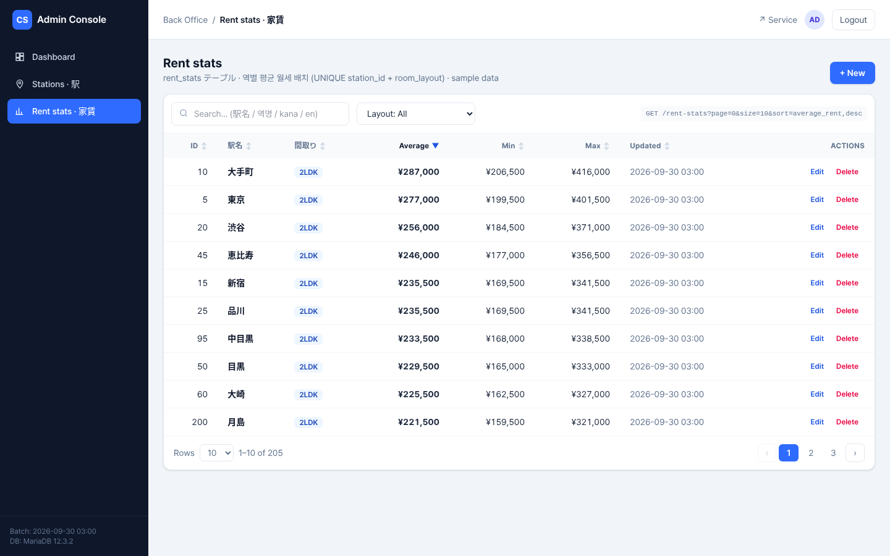
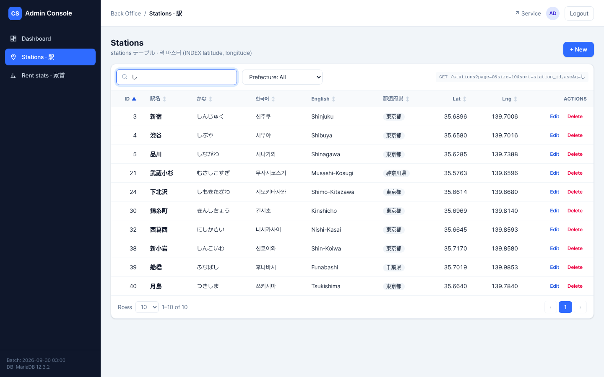
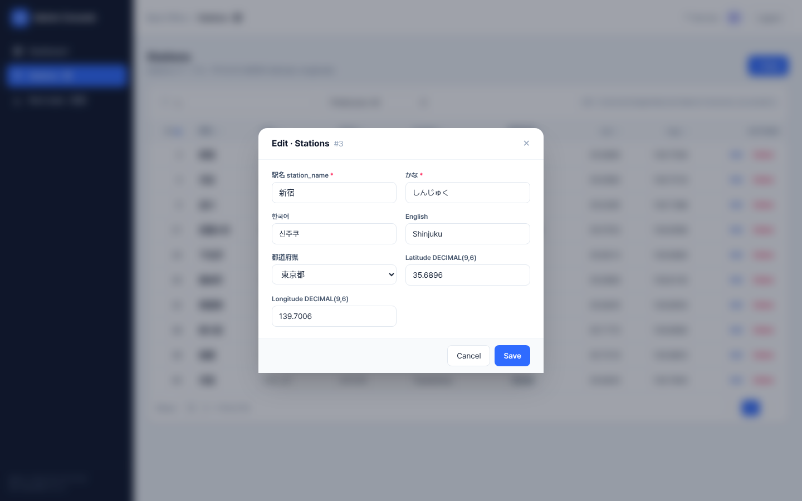

# 🚆 commute-rent-web — Commute Simulator Tokyo Web Frontend

> 首都圏移住者のための家賃・通勤シミュレーター (B2C Web UI + B2B 管理コンソール)

[한국어](README.ko.md) | [日本語](README.md) · バックエンド・DB: [commute-rent-api][backend-repo]

> [!NOTE]
> 現在の状態: **フロントエンドのプロトタイプ v0.1.0** です。API は内蔵の **モック API（`/api/*`、Next.js Route Handlers + インメモリDB）** で動作し、Spring Boot バックエンドは予定です。
> 家賃・通勤時間は **ポートフォリオ用のサンプルデータ** です（モック: 41 駅、勤務地 6 駅）。家賃は実データの入手が難しいため一時的に生成したデータを使用し、路線・駅データはバックエンドで HeartRails Express API により生成する予定です（[データ出典][backend-data]）。

状態: ✅ 実装済み · 🟡 一部実装 · 🔜 予定

---

## 1. プロジェクト概要 (Project Overview)
- **ターゲット (Target):** 首都圏（東京・神奈川・埼玉・千葉）への移住を検討している IT エンジニアおよび会社員
- **主な機能 (Key Features):** 勤務地と希望家賃を入力すると、最適な居住エリア（駅）を地図上に推薦し、家賃相場と通勤時間をシミュレーションします。
- **構成:**
  - **B2C (SSR):** 検索・地図画面、駅詳細ポップアップ、ログイン・新規登録 — 韓国語・日本語
  - **B2B 管理コンソール (CSR):** 管理者ログイン (JWT)、ダッシュボード、駅マスタ・家賃統計の管理 (CRUD)

## 2. 技術スタックと採用理由 (Tech Stack & Why This Tech?)
| 技術 | バージョン | 採用理由 |
|---|---|---|
| **Next.js (App Router)** | 16.3.5 | サーバーサイドレンダリング (SSR) による初期表示速度の向上と SEO 対策。管理画面は CSR に分離 |
| **React** | 19.2.8 | `useTransition` により、フィルター変更時の画面遷移中の状態（ローディングバー）を処理 |
| **TypeScript** | 5.x | DB スキーマを反映した型 (`src/lib/types.ts`) により、バックエンド API (Spring Boot) とのデータ通信時のランタイムエラーを事前に遮断 |
| **Tailwind CSS** | 4.x | UI ライブラリを使わず、B2C・管理 UI ともに Tailwind で実装 (`@tailwindcss/postcss`) |
| **axios** | 1.18.0 | ブラウザ用（インターセプターで Bearer JWT を自動付与、タイムアウト 8 秒）と SSR 用（タイムアウト 5 秒）のインスタンスを分離 |
| **react-leaflet + Leaflet** | 5.0.0 + 1.9.4 | OpenStreetMap タイルによる地図。API キー不要 |
| ESLint | 9 (`eslint-config-next` 16.3.5) | 静的解析 |

## 3. 主な機能 (Features)

### B2C — 検索・地図 (`/ko`, `/ja`)
| 機能 | 状態 |
|---|---|
| 勤務地の駅 / 家賃上限 (50,000〜250,000円) / 間取り (1R・1K・1DK・1LDK・2LDK) / 乗換回数 (0〜2回) / 通勤時間の上限 (10〜90分) のフィルター | ✅ |
| サーバーサイドでのフィルタリング (SSR) により結果を HTML でレンダリング、平均家賃の安い順（同額は通勤時間順） | ✅ |
| 家賃帯 4 色のマーカー（〜7万 / 7〜9万 / 9〜11万 / 11万円〜）、勤務地マーカー、表示範囲の自動調整、凡例 | ✅ |
| リスト ↔ 地図の連動（行クリックで地図移動・ポップアップ、マーカークリックで該当行を選択） | ✅ |
| 駅詳細ポップアップ: 駅名（日・韓・かな・英）、路線バッジ、平均家賃・範囲、通勤時間、乗換回数 | ✅ |
| お気に入りのトグル（楽観的更新 + localStorage。ログインチェックなし、モックは user_id=1 固定） | 🟡 |
| ログイン・新規登録 (`/{locale}/login`、モック JWT、パスワード 8 文字以上) | ✅ (モック) |
| マイページ (`/{locale}/mypage`) | 🔜 |

### B2B — 管理コンソール (`/admin`)
| 機能 | 状態 |
|---|---|
| 管理者ログイン、JWT（role=ADMIN、有効期限 8 時間）によるクライアント側ガード — トークンなし・期限切れはログイン画面へ遷移 | ✅ (モック JWT) |
| ダッシュボード: 駅・路線・家賃統計・通勤データの件数、1K 平均家賃、都道府県別 1K 平均、1K 上位/下位 5 駅 | ✅ |
| データグリッド（駅マスタ / 家賃統計）: サーバー側ページング・ソート・検索（デバウンス）・フィルター | ✅ |
| 登録・編集モーダル、削除確認ダイアログ、`(station_id, room_layout)` 重複時の 409 エラー表示 | ✅ |

## 4. UI/UX & 実装ポイント (UI/UX & Implementation)
フロントエンドならではの技術的課題を以下のように解決しました。

- **URL Query Parameters を用いた状態管理:**
  複雑な検索条件（家賃上限、通勤時間、乗り換え回数など）を URL の Query Parameter (`dest`, `maxRent`, `layout`, `maxTransfers`, `maxMinutes`) と同期させました。これにより、ユーザーがページをリフレッシュしたり、検索結果 URL を共有しても状態が維持される UX を実現しました。不正な値はエラーにせず既定値に補正し、リンクコピー・リセットボタンを提供しています。
  例) `/ja?dest=3&maxRent=110000&layout=1K&maxTransfers=1&maxMinutes=45`
- **i18n 多言語対応:**
  `/ko`・`/ja` のロケールパスで韓国語・日本語を切り替え、切り替え時も検索条件を維持します。ロケール別の title・description と hreflang (alternates) を出力し、それ以外のロケールは 404 です。辞書は `src/lib/i18n.ts` に直接定義しています（i18n ライブラリは不使用）。
- **SSR と地図 CSR の分離:**
  検索は Server Component でフィルタリングして HTML としてレンダリングし、Leaflet の地図は `next/dynamic` (`ssr: false`) でクライアント側のみで読み込みます。
- **バックエンド切り替えの構成:**
  SSR (`serverApi.ts`) とブラウザ (`http.ts`) の接続先を環境変数で切り替えます。SSR はバックエンド未設定・障害時にモックデータへフォールバックします。
- **レスポンシブ:** `lg` 未満ではリストを地図の下に配置し、管理サイドバーは `md` 以上で表示します。

## 5. モック API と環境変数 (Mock API & Environment)
`.env.example` を `.env.local` にコピーします。**空のままにすると内蔵のモック API (`/api/*`) を使用します。**

| 変数 | 使用箇所 | 例 |
|---|---|---|
| `API_BASE_URL` | SSR (Server Component) | `http://localhost:8080/api` |
| `NEXT_PUBLIC_API_BASE_URL` | ブラウザの axios インスタンス | `http://localhost:8080/api` |

- モック API は `src/app/api/**`（Route Handlers）と `src/lib/store.ts`（インメモリDB）で実装しています。サーバーを再起動するとデータは初期化されます。
- 管理一覧 API は Spring Data Pageable 形式: `?page=0&size=10&sort=field,asc&q=…` → `{content, totalElements, totalPages, number, size}`
- モック JWT は署名検証のないデモ専用です（本実装: Spring Security + 署名付き JWT の予定）。
- エンドポイント一覧 (API-001〜017) と DB 設計は [commute-rent-api の README][backend-repo] を参照してください。

## 6. ディレクトリ構成 (Directory Structure)
```text
commute-rent-web/
├── src/
│   ├── app/
│   │   ├── [locale]/          # B2C (SSR): /ko, /ja, /{locale}/login
│   │   ├── admin/             # B2B 管理コンソール (CSR): login, (console)/ ダッシュボード・stations・rent-stats
│   │   ├── api/               # モック REST API (Route Handlers)
│   │   └── page.tsx           # / → /ko へリダイレクト
│   ├── components/            # SearchFilters, ResultsExplorer, MapView, AuthForm, Header, admin/DataGrid …
│   └── lib/
│       ├── types.ts           # DB スキーマを反映した型
│       ├── i18n.ts            # ko / ja 辞書
│       ├── query.ts           # URL クエリの解析・既定値、家賃帯
│       ├── http.ts            # ブラウザ用 axios (JWT インターセプター)
│       ├── serverApi.ts       # SSR 用 axios (モックへのフォールバック)
│       ├── auth.ts            # モック JWT
│       └── store.ts, mockData.ts  # モックのインメモリDB・サンプルデータ
├── screenshots/               # 画面キャプチャ
└── .env.example
```

## 7. 実行手順 (Getting Started)
ローカル環境での実行方法です。フロントエンドは標準ポートである `3000` を使用します。バックエンドなしでもモック API で単独実行できます。

```bash
# 0. リポジトリのクローン
git clone https://github.com/OWNER/commute-rent-web.git
cd commute-rent-web

# 1. 依存パッケージのインストール
npm install

# 2. ローカル開発サーバーの起動 (Port: 3000)
npm run dev

# （任意）本番ビルド・起動 / Lint
npm run build && npm start
npm run lint
```

| URL | 画面 |
|---|---|
| `http://localhost:3000/ja`, `/ko` | B2C 検索・地図（`/` は `/ko` へリダイレクト） |
| `/ja/login`, `/ja/login?mode=signup` | ログイン・新規登録（モック） |
| `/admin/login` | 管理コンソール — デモアカウント `admin@commute.dev` / `admin1234` |

## 8. スクリーンショット (Screenshots)
| B2C 検索・地図（韓国語） | B2C 検索・地図（日本語） |
|---|---|
|  |  |
| **駅詳細ポップアップ** | **新規登録** |
|  |  |
| **管理者ログイン** | **管理ダッシュボード** |
|  |  |
| **家賃統計グリッド** | **駅マスタグリッド** |
|  |  |
| **編集モーダル** | |
|  | |

## 9. 関連ドキュメント (Documents)
設計ドキュメント（要件定義書・画面設計書・API 仕様書・テーブル定義書・テスト仕様書、日・韓）と通勤時間 API 調査は、バックエンドリポジトリ [commute-rent-api][backend-repo] の `docs/` にあります。

## 10. ロードマップ (Roadmap)
- [x] B2C 検索・地図（SSR、URL クエリによる状態管理、ko/ja）
- [x] B2B 管理コンソール（ダッシュボード、データグリッド CRUD）
- [x] モック API・環境変数によるバックエンド切り替えの構成
- [ ] 🔜 Spring Boot API との連携（本番の JWT 認証）
- [ ] 🔜 お気に入りのログイン必須化（未ログイン時はログイン画面へ遷移）
- [ ] 🔜 マイページ（お気に入り一覧・削除、駅を中心にした地図へ移動）
- [ ] 🔜 管理画面の選択肢をモックデータの直接 import から API (`/api/prefectures`) に置き換え
- [ ] 🔜 HeartRails Express のデータ使用時に画面へ「HeartRails Express」のクレジットを表記（無料利用の条件）
- [ ] 🔜 通勤時間が推定値であることを駅詳細ポップアップに表記
- [ ] 🔜 DB と型の差異の解消（`station_name_ko`、路線の `company`/`color` は現在 DB に未定義）

---
※ 家賃・通勤時間はポートフォリオ用のサンプルデータです。地図 © OpenStreetMap contributors · © Kim GwangJin

<!-- OWNER を GitHub のユーザー名に置き換えてください（デフォルトブランチ main を想定）。 -->
[backend-repo]: https://github.com/OWNER/commute-rent-api/blob/main/README.ja.md
[backend-data]: https://github.com/OWNER/commute-rent-api/blob/main/README.ja.md#6-データ出典-data-sources
